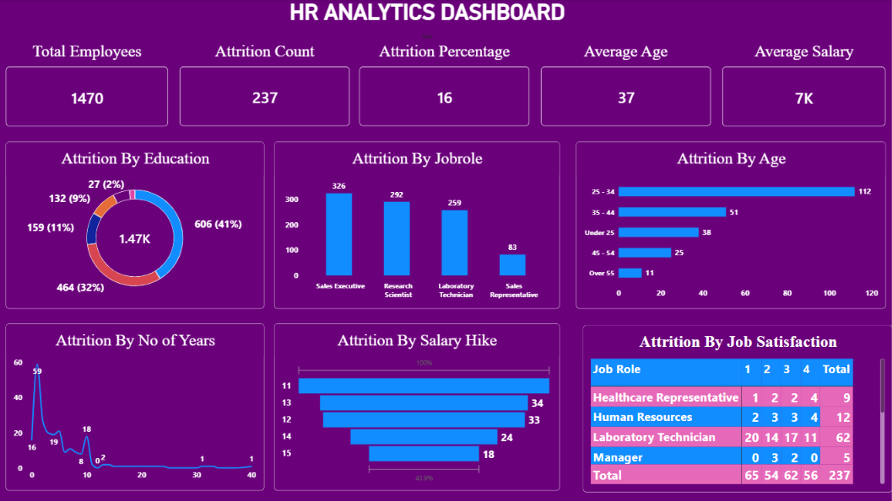

# HR-Analytics-Dashboard
# HR Analytics Dashboard – Power BI

## Project Overview
Developed an interactive HR Analytics Dashboard using Microsoft Power BI to analyze employee attrition and workforce trends.

## Dashboard Features
- Total employee count
- Employee attrition count and percentage
- Average employee age and salary
- Attrition by education
- Attrition by job role
- Attrition by age group
- Attrition by years of service
- Attrition by salary hike
- Job satisfaction by job role

## Tools & Technologies
- Microsoft Power BI
- Power Query
- DAX
- Data Visualization

## Dashboard Preview

## Objective
To analyze employee attrition patterns and provide insights that can help HR teams understand workforce trends and support data-driven decisions.

## Key Insights
The dashboard presents employee attrition across age groups, education levels, job roles, and salary hikes to help identify workforce patterns.